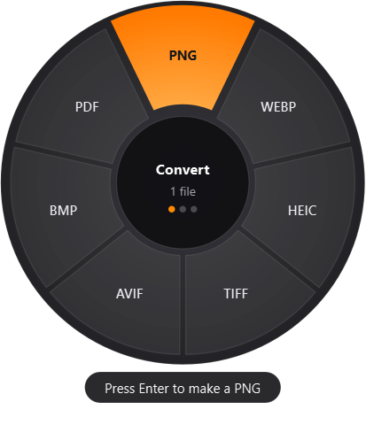
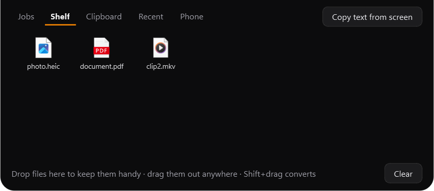

<p align="center">
  <picture>
    <source media="(prefers-color-scheme: dark)" srcset="assets/brand/wordmark-dark.png">
    
  </picture>
</p>

<p align="center">
  <b>Drag a file, tap a key, pick a format.</b><br>
  A fast file converter and file toolbox for Windows. Everything happens on your PC: nothing is uploaded.
</p>

<p align="center">
  <a href="https://github.com/aarayhan/PomeloO/releases/latest"></a>
  <a href="https://github.com/aarayhan/PomeloO/releases"></a>
  <a href="https://github.com/aarayhan/PomeloO/actions/workflows/build.yml"></a>
  
  <a href="LICENSE"></a>
</p>

<p align="center">
  <a href="https://github.com/aarayhan/PomeloO/releases/latest"><b>⬇&nbsp; Download PomeloO for Windows</b></a>
  &nbsp;·&nbsp;
  <a href="https://pomeloo.netlify.app/"><b>Website and how-to guides</b></a>
</p>

<p align="center">
  
  &nbsp;&nbsp;
  
</p>

## What it does

While you drag a file in Explorer, tap **Shift** and a wheel of formats appears under the cursor. Drop the
file on one and the converted copy appears next to the original. Tap **Ctrl** for tools, **Alt** for
actions, or drag the file to the top of the screen and drop it on the **notch**.

- **275+ conversions**: photos (JPG, PNG, WebP, HEIC, AVIF, TIFF, BMP, SVG), audio, video and GIF, PDF,
  Word, Markdown, EPUB, slides, spreadsheets, subtitles and archives (RAR too).
- **34 tools**: compress to a size, photo editor with live preview, annotate, add a background, crop,
  redact with automatic face and text detection, collage, trim, split, join, speed, video snapshots,
  loudness, bleep, audio visualizer, burn-in subtitles, PDF merge / split / organize / password /
  watermark / page numbers, copy text (OCR), searchable PDF, metadata, QR reader, extract archives.
- **8 actions** for any file or folder: Share, Float, Copy, Move, Copy Path, Terminal, Rename (with date
  taken and numbering) and **Send to Phone** (a QR code; works both ways, over your Wi-Fi).
- **The notch**: a black pill at the top of the screen. Hover it for your shelf, running jobs,
  clipboard history, recent results and the phone QR. Drag a file to it for drop zones like *Fit
  WhatsApp*, *Fit Email* and *Fit Web*. New downloads and copied screenshots get one-click ideas.
- **Everyday extras**: copy text from anything on screen (**Win+Ctrl+T**), paste a copied image into a
  folder as a file (**Ctrl+V**), recipes (several steps as one ★ button, optionally watching a folder),
  and History with undo.

<p align="center">
  
</p>

The full list is in [docs/features.md](docs/features.md).

## Install

1. Download **`PomeloO-Setup-x.y.z.exe`** from [Releases](https://github.com/aarayhan/PomeloO/releases/latest)
   and run it. No admin rights are needed: it installs for your user only, with a Start menu entry and
   (optionally) the Explorer right-click menu.
2. Windows may say *"Windows protected your PC"* because the installer isn't code-signed yet. Click
   **More info → Run anyway**.
3. PomeloO lives in the tray (the orange icon) and starts with Windows. On its first start it compresses
   its own folder with Windows' built-in file compression (about 690 MB → 240 MB on disk).

Prefer no installer? Unzip **`PomeloO-x.y.z-portable.zip`** anywhere and run `PomeloO.exe` (tray menu →
**Add to Explorer menu** for the right-click menu). To uninstall: Settings → Apps → PomeloO; that also
removes the right-click menu and the start-with-Windows entry.

Requires Windows 10 (1809 or newer) or Windows 11, 64-bit.

## How to use

| Do this | To |
|---|---|
| Drag a file in Explorer, tap **Shift** | convert it |
| Drag a file, tap **Ctrl** | open the tools |
| Drag a file or a folder, tap **Alt** | file actions |
| Drag a file to the **top of the screen** | the notch's drop zones: convert, shelf, phone, *Fit WhatsApp / Email / Web* |
| Hover the **notch** (top centre) | shelf, jobs, clipboard, recent results, phone |
| Select files, press **Ctrl+Shift+Space** | the wheel by keyboard (nothing selected: whatever you copied) |
| Press **Win+Ctrl+T**, drag over the screen | copy any text or QR code you can see |
| Copy an image, press **Ctrl+V** in a folder | save it there as a PNG |
| Right-click → Show more options → **PomeloO** | the same as a classic menu |
| Tray icon | Receive from phone, Recipes, History, Settings |

Keys, shortcuts, the notch and everything else are in tray menu → **Settings**.

### Slides
PPT and PPTX are rendered by a real Office engine for full fidelity: an installed LibreOffice, WPS Office
or PowerPoint. If none is installed, PomeloO downloads a private copy of LibreOffice the first time you
convert slides (about 375 MB, from The Document Foundation, checksum-verified, no admin rights, stored in
`%LOCALAPPDATA%\PomeloO\libreoffice`).

## Privacy

No telemetry, no accounts, no uploads. PomeloO uses the network in only three cases: the one-time
LibreOffice download above and **Send to Phone** (both started by you; Send to Phone shares files on your own
Wi-Fi only, behind a random link, and only while its QR code is open), and the **update check**: once a day it
reads the latest release from GitHub and, if it's newer, downloads the installer, checks its SHA-256 and installs
it while you're not using the PC. Nothing about you or your files is sent; Settings → *Update automatically*
turns it off. The clipboard history stays in memory and
skips anything a password manager marks as private. The notch never appears in screenshots or screen
sharing.

## Build from source

```powershell
uv venv --python 3.13 .venv
uv pip install --python .venv\Scripts\python.exe -e . pyinstaller ziglang
.venv\Scripts\python.exe tests\test_convert.py        # converts every pair and runs every tool
powershell -File scripts\build.ps1 -NativeOnly         # the C helpers (needed to run from source)
.venv\Scripts\python.exe -m pomeloo                    # run the tray app from source
powershell -File scripts\build.ps1 -Installer          # dist\PomeloO + dist\PomeloO-Setup-<version>.exe
```

`native\` holds two small C helpers compiled with `zig cc` (installed by pip, no Visual Studio needed):
`pomeloo-send.exe` is what the Explorer menu runs (it hands the request to the tray app in a few
milliseconds), and `pomeloo_native.dll` watches for the drag gestures on a native thread, so the Python
side sleeps until something happens. The installer is built with Inno Setup 6. Pushing a `vX.Y.Z` tag
makes GitHub Actions test, build and publish a release.

Command line, for scripting:

```powershell
pomeloo list photo.jpg
pomeloo convert webp photo.jpg
pomeloo tool compress video.mp4 --set percent=40
pomeloo --register        # or --unregister: the Explorer right-click menu (current user only)
```

## License

[GNU AGPL-3.0](LICENSE). Bundled components keep their own licenses, see
[THIRD_PARTY_NOTICES.md](THIRD_PARTY_NOTICES.md).

Inspired by the drag-and-tap converter idea of Tangerine for macOS. PomeloO is an independent,
from-scratch project and is not affiliated with it.
